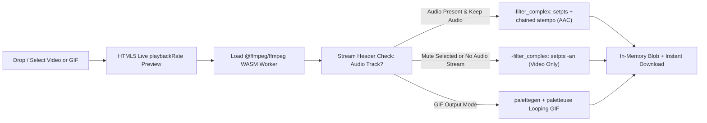

<div align="center">

# ChangeVideoSpeed

**100% Client-Side Online Video & GIF Speed Controller — Speed Up or Slow Down Videos in Browser RAM with Zero Cloud Uploads and No Watermarks.**

[](https://changevideospeed.github.io/)
[](https://astro.build/)
[](https://preactjs.com/)
[](https://ffmpegwasm.netlify.app/)
[](https://tailwindcss.com/)
[](LICENSE)
[](https://kisharadilshan.gumroad.com/coffee)

[Launch Web App](https://changevideospeed.github.io/) · [Report an Issue](https://github.com/changevideospeed/changevideospeed.github.io/issues) · [Support the Developer](https://kisharadilshan.gumroad.com/coffee)

</div>

---

## Overview

**ChangeVideoSpeed** ([changevideospeed.github.io](https://changevideospeed.github.io/)) is a privacy-first, installable web application built with **Astro** and **FFmpeg WebAssembly** (`@ffmpeg/ffmpeg`) that runs **100% inside your browser's local RAM**.

Unlike traditional cloud editors that upload large video files to remote servers, impose file-size paywalls, or stamp watermarks on exports, ChangeVideoSpeed processes single files and batch queues locally—allowing users to slow down footage (`0.1x`–`0.95x`), create crisp high-speed time-lapses (`1.25x`–`10.0x`), fix iPhone slo-mo playback rates, or export sped-up animated GIFs even completely offline.

---

## Key Features

- **100% Local RAM Execution (Zero Uploads, Zero Watermarks):** Files never leave the user's device; all decoding, filtering, and H.264/AAC/GIF encoding occur inside a Web Worker via `@ffmpeg/core`.
- **Precision Speed Engine (`0.1x` to `10.0x`):**
  - Six 1-click presets (`0.25x`, `0.5x`, `1.25x`, `1.5x`, `2x`, `4x`) plus a continuous `0.1x`–`10.0x` slider with `±0.1x` step controls and live estimated duration calculation.
  - Real-time HTML5 `<video>` `playbackRate` preview before committing to an encode.
- **Synced Audio Pitch & Mute Control:**
  - Automatically inspects input stream headers and preserves original audio pitch by chaining FFmpeg `atempo` filters within `[0.5, 2.0]` alongside `[0:v]setpts=PTS/SPEED[v]`.
  - Automatic `-an` fallback for silent/video-only sources, plus an explicit **Mute Audio** toggle.
- **Animated GIF Speed Conversion:** Supports slowing down or speeding up GIFs (`palettegen=stats_mode=diff` + `paletteuse=dither=bayer`) or converting MP4/MOV clips into sped-up looping GIFs.
- **Batch Queue Support:** Load multiple videos at once, preview/switch individual queue items, monitor per-file progress, cancel safely with `AbortController`, and export individually or all at once.
- **Streamlined First-Fold UX & Mobile/Tablet Drawer:**
  - Initial screen dedicates `100dvh` to the primary headline and interactive dropzone with a collapsible workspace mode selector (`Change Video Speed`, `Speed Up Video`, `Slow Down Video (Slo-Mo)`, `Change GIF Speed`).
  - Full inline action bar on desktop (`>= 1024px`) and a single `48×48px` drawer toggle (`< 1024px`) for phones and tablets.
- **8-Language Internationalization (i18n):** Native UI translations, localized URLs, SEO metadata, breadcrumbs, and FAQ schemas across **8 languages**.
- **Offline-First PWA:** Installable via "Add to Home Screen" with `public/sw.js` (`changevideospeed-offline-v4`) and auto-generated `sw-assets.json` precaching routes, UI bundles, and `ffmpeg-core.wasm` for offline editing.

---

## Processing Architecture



1. **Zero-Network Encoding:** `@ffmpeg/core` JS and `.wasm` binaries load locally from `/ffmpeg/` (precached by the Service Worker) with automatic jsDelivr/unpkg CDN fallback if needed.
2. **Stream Safety:** Odd-width/height mobile recordings are automatically padded to even dimensions (`pad=ceil(iw/2)*2:ceil(ih/2)*2`) when required by `libx264`.

---

## Supported Languages

| Language | Code | Localized Route |
| :--- | :--- | :--- |
| English | `EN` | [`/`](https://changevideospeed.github.io/) |
| Español (Spanish) | `ES` | [`/es/`](https://changevideospeed.github.io/es/) |
| Português (Portuguese) | `PT` | [`/pt/`](https://changevideospeed.github.io/pt/) |
| Deutsch (German) | `DE` | [`/de/`](https://changevideospeed.github.io/de/) |
| Français (French) | `FR` | [`/fr/`](https://changevideospeed.github.io/fr/) |
| 日本語 (Japanese) | `JA` | [`/ja/`](https://changevideospeed.github.io/ja/) |
| 中文 (Chinese) | `ZH` | [`/zh/`](https://changevideospeed.github.io/zh/) |
| Русский (Russian) | `RU` | [`/ru/`](https://changevideospeed.github.io/ru/) |

---

## Tech Stack

| Layer | Technology | Role |
| :--- | :--- | :--- |
| **Framework** | **Astro `^7.4.11`** (`output: 'static'`) | Static HTML generation for GitHub Pages with Islands Architecture. |
| **Interactive Island** | **Preact `^11.2.0` + `@astrojs/preact`** | Lightweight `client:load` workspace controller ([VideoSpeedWorkspace.tsx](src/components/VideoSpeedWorkspace.tsx)). |
| **Styling & Theme** | **Tailwind CSS v4 + CSS Variables** | Light/Dark Sand & Teal theme with `localStorage` persistence (`cvs_theme`). |
| **Video Engine** | **`@ffmpeg/ffmpeg ^0.12.15` + `@ffmpeg/core ^0.12.10`** | WebAssembly worker executing video speed, chained `atempo`, and GIF filters ([ffmpegEngine.ts](src/lib/ffmpegEngine.ts)). |
| **Offline PWA** | **Web App Manifest + Service Worker** | Offline-first caching via [sw.js](public/sw.js) and build-time [generate-sw-manifest.mjs](scripts/generate-sw-manifest.mjs). |
| **Technical SEO** | **`@astrojs/sitemap` + [sitemap.xml.ts](src/pages/sitemap.xml.ts) + JSON-LD** | Dual GSC sitemaps (`sitemap.xml` & `sitemap-index.xml`), full `hreflang` graph, canonicals, and strict zero-fake-rating schema (`WebApplication`, `HowTo`, `FAQPage`, `BreadcrumbList`). |
| **Analytics** | **Google Tag Manager & GA4** | Async head integration for `GTM-NPFG4XBJ` and `G-5RB9RRC0D1`. |

---

## Color Palette Specification

| Token Name | Hex Code | Usage |
| :--- | :--- | :--- |
| **Soft Sand Beige** | `#F2DEBA` | Surface cards, navbar background (light), primary CTA (dark mode), badges |
| **Pale Cream Ivory** | `#FFEFD6` | Primary page background (light mode), primary typography (dark mode) |
| **Deep Ocean Teal** | `#0E5E6F` | Primary CTA buttons (light mode), primary headings & text (light mode), cards (dark mode) |
| **Muted Aquamarine** | `#3A8891` | Borders, hover accents, secondary typography, shimmer progress bars |
| **Pure Canvas White** | `#FFFFFF` | Workspace container background (light mode) |
| **Deep Night Black** | `#121212` | Primary page background (dark mode, paired with `#1A2F35` workspace surface) |

---

## Project Structure

```text
changevideospeed.github.io/
├── .github/workflows/
│   └── deploy.yml                  # GitHub Actions CI/CD workflow for GitHub Pages
├── public/
│   ├── .nojekyll                   # Bypass Jekyll processing on GitHub Pages
│   ├── favicon.svg                 # Crisp vector brand icon
│   ├── icons/
│   │   ├── icon-192.png            # PWA maskable/any icon (192x192)
│   │   └── icon-512.png            # PWA maskable/any icon (512x512)
│   ├── manifest.webmanifest        # Standalone PWA configuration
│   ├── og-image.png                # Open Graph / Twitter social preview card
│   ├── robots.txt                  # Crawler rules + dual sitemap declarations
│   └── sw.js                       # Offline-first Service Worker
├── scripts/
│   ├── generate-sw-manifest.mjs    # Generates dist/sw-assets.json after build
│   └── sync-ffmpeg.mjs             # Copies @ffmpeg/core WASM assets to public/ffmpeg/
├── src/
│   ├── components/
│   │   ├── Header.astro            # Desktop inline navbar & <1024px toggle drawer + PWA modal
│   │   ├── HomePage.astro          # First-fold hero, SEO guides, comparison table & FAQ
│   │   ├── JsonLdSchema.astro      # Zero-fake-rating structured data injector
│   │   └── VideoSpeedWorkspace.tsx # Preact 4-step video/GIF controller island
│   ├── i18n/
│   │   ├── ui.ts                   # Complete 8-language translation dictionary
│   │   └── utils.ts                # Locale routing & translation helpers
│   ├── layouts/
│   │   └── BaseLayout.astro        # Dynamic <head> SEO, OG/Twitter, GTM/GA4 & SW registration
│   ├── lib/
│   │   └── ffmpegEngine.ts         # FFmpeg.wasm loader, stream detector & encoder
│   ├── pages/
│   │   ├── [lang]/index.astro      # Localized static routes (/es/, /pt/, ..., /ru/)
│   │   ├── index.astro             # Default English root route (/)
│   │   └── sitemap.xml.ts          # Flat multilingual XML sitemap endpoint
│   └── styles/
│       └── global.css              # Tailwind v4 + Sand & Teal light/dark CSS tokens
├── astro.config.mjs                # Static Astro config, i18n routing & Vite exclusions
├── package.json                    # Scripts and pinned dependencies
└── tsconfig.json                   # Strict TypeScript + Preact JSX config
```

---

## Local Development

### Prerequisites

- **Node.js `20+`** (Node `22` used in CI)
- **npm `10+`**

### Setup & Commands

```bash
# 1. Clone the repository
git clone https://github.com/changevideospeed/changevideospeed.github.io.git
cd changevideospeed.github.io

# 2. Install dependencies (postinstall syncs @ffmpeg/core into public/ffmpeg/)
npm install

# 3. Start local development server
npm run dev

# 4. Run Astro diagnostics and TypeScript type checking
npm run check

# 5. Build static site into dist/ and generate dist/sw-assets.json
npm run build

# 6. Preview the production build locally
npm run preview
```

---

## Deployment (GitHub Pages CI/CD)

Deployment is automated via [`.github/workflows/deploy.yml`](.github/workflows/deploy.yml):

1. Triggers automatically on every `push` to `main` (or manually via `workflow_dispatch`).
2. Ensures `public/.nojekyll` is present so `_astro/` and asset folders serve cleanly.
3. Runs `withastro/action@v3` on Node `22` to install packages, run `npm run build`, and upload the `dist/` artifact.
4. Deploys to the `github-pages` environment via `actions/deploy-pages@v4`.

Search engine discovery is configured with:
- [`/sitemap.xml`](src/pages/sitemap.xml.ts) — Flat Google Search Console–friendly XML listing all 8 locale URLs with full `xhtml:link` `hreflang` alternates (`x-default` included).
- `/sitemap-index.xml` — Generated alongside `sitemap-0.xml` by `@astrojs/sitemap`.
- [`public/robots.txt`](public/robots.txt) — Explicitly advertises both sitemaps.

---

## Support the Developer

If **ChangeVideoSpeed** saved you editing time or helped you change video speed privately without watermarks, consider supporting ongoing open-source maintenance:

👉 **[Buy the Developer a Coffee on Gumroad](https://kisharadilshan.gumroad.com/coffee)**

---

## License

Copyright © 2026 **Kishara Dilshan (ChangeVideoSpeed)**. Licensed under the **MIT License** — see [`LICENSE`](LICENSE) for details.
